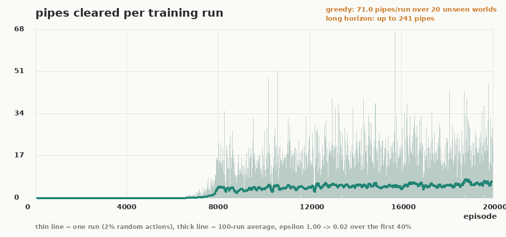

# rl-flappy

A flappy-bird-shaped toy where a **table of 6,000 numbers** learns to fly. No neural
nets, no gym, no PyTorch. numpy and Pillow are the only dependencies, and Pillow is
only used to draw the videos.

The agent sees four small integers per frame:

| what | meaning |
|---|---|
| `dx` | distance to the next pipe |
| `dy` | height offset from the middle of that pipe's gap |
| `vy` | vertical speed, 5 buckets |
| `y` | absolute height, 10 buckets |

6 x 10 x 5 x 10 = 3,000 states, two actions (coast / flap), so 6,000 Q values.
Q-learning with a lookup table is the entire algorithm.

## Results (seed 23, 20,000 episodes, 45 seconds of one CPU core)

| | pipes per run |
|---|---|
| episodes 1 to 100 | 0.00 |
| last 100 episodes (with 2% random actions still on) | 6.80 |
| greedy, 20 worlds it never saw | **71.00** (every run hit the step cap) |
| greedy, long horizon, 8,000 step cap | 241 on all 5 worlds |
| best single training run | 67 |

Only 1,061 of the 3,000 states are ever visited. The agent never needs the rest of
the table.



## The videos

Three cuts ship in `videos/`:

- `rl_flappy_rounds_4k.mp4`: one checkpoint per round, 3840x2160 at 60 fps, ends the
  moment a bird clears the 50th pipe (37s)
- `rl_flappy_swarm.mp4`: 100 checkpoints on one level, with the analytics panel
  (1720x900, 29s)
- `rl_flappy_learning.mp4`: four checkpoints side by side, each panel freezing when
  its bird dies (720x540, 23s)

`render.py` puts four checkpoints on one level, side by side, and freezes each panel
when its bird dies. `swarm.py` drops **100 checkpoints on a single level**, one bird
per checkpoint, every 200 episodes from 0 to 19,800, coloured red (untrained)
through yellow to green (trained).

The swarm panel is 1720x900 and carries five live readouts: the alive and crashed
counts, a top-of-the-flock leaderboard (episode count and pipes for the five birds
furthest through), one bar per bird showing pipes cleared so far (bars freeze grey
where a bird died, so the chart is also a death record), a histogram of when the
crashes happened, and a step timeline under the ground. In the field itself every
crash leaves a small cross where the bird went down, so the wall of X marks tracks
the learning gap.

On that swarm level, 750 steps long:

| | birds |
|---|---|
| never cleared a pipe | 40 |
| cleared 1 to 5 | 11 |
| cleared 6 to 20 | 15 |
| still flying when the tape stops | 34 |

All 34 survivors had trained for at least 7,600 episodes. One bird trained for
18,600 still crashed early on this level, because a 3,000 state table cannot see
every gap position exactly. That is worth knowing before believing the 71 pipe
average: the policy is very good on average and not perfect per level.

### Round robin (`rounds.py`)

One checkpoint per round. A group of 12 birds from that checkpoint starts, the next
round begins only when the last one crashes, and the run advances to the next
checkpoint. The video stops the moment a single bird clears the 50th pipe. The play
field fills the frame height with the labels living in the side margins, so nothing
sits on top of the game. Long runs switch to 6x playback after 3 pipes and say so.

On level 31337 that plays out as:

| round | checkpoint | result |
|---|---|---|
| 1 to 4 | 0 to 6,000 episodes | wiped out before the first pipe |
| 5 | 8,000 | 31 pipes |
| 6 | 9,000 | 36 pipes |
| 7 | 10,000 | **one bird cleared 50**, video ends |

```bash
python3 rounds.py                       # 4K 60fps master, 37s (about 3m40s to render)
python3 rounds.py --height 1080         # same layout at 1080p, for quick drafts
python3 rounds.py --dry-run             # round outcomes and frame count, no encoding
python3 rounds.py --target 80 --schedule 0,5000,8000,9000,10000,12000
```

Output is 3840x2160 at 60 fps, about 7 MB at crf 23. The layout is designed in a
900-pixel-tall space and multiplied by height, so 1080p and 4K are the same
composition: 4:3 play field at full height, centred, with 16:9 dark margins holding
the checkpoint on the left and the flock counter on the right. Type is Space Grotesk
(`assets/fonts/`), replacing DejaVu.

The motion is real, not decoration: the sim runs at 40 steps per second and the video
samples it at 60 fps with interpolation, so scrolling is smooth instead of stepped,
and fast forward raises the sampled rate rather than dropping frames. Around that:
drifting parallax clouds, labels that slide and fade in at the start of every round,
death crosses that pop in over five steps, captions that fade and rise, a crossfade
between rounds, and a winner card that scales up. The intro card holds about 3.3
seconds so it can actually be read.

A group is 12 copies of one policy with tiny start differences (`--spread` 0.25 world
px horizontally, `--jitter` 1.3 vertically), because identical policies fly
identically and would stack into one sprite. Be aware how sharp that is: the same
level at `--jitter 0.9` has the 8,000 checkpoint reach 50 pipes instead of 31, since
a 12-bird group is a best-of-12 sample of a policy that is near a knife edge. The
round order is not monotone either (the real checkpoints are not), so a later
checkpoint can do worse than an earlier one.

```bash
python3 train.py --snap-every 100        # 201 checkpoints, one every 100 episodes
python3 render.py --episodes 0,7500,8000,20000 --steps 750
python3 swarm.py --birds 100 --seed 4242 --steps 750 --pick even
```

`--pick even` spaces the birds evenly across the training run. `--pick score` picks
one bird per distinct survival length instead, which front-loads fewer instant
deaths. `--dry-run` scores and picks without rendering.

## Run it

```bash
python3 train.py                      # 20k episodes, writes q_table.json + stats + curve
python3 watch.py                      # fly the trained agent in your own terminal
python3 watch.py --seed 99 --fps 60   # try a different world
python3 test_env.py                   # failure-first checks
```

`train.py` also takes `--episodes`, `--seed`, `--alpha`, `--gamma`, `--snap-marks`
(which checkpoints the four-panel video uses) and `--snap-every`.

## The three things that actually mattered

**1. Reward scale, not episode count.** The first version paid `+1` per surviving
step, `+2` per pipe and nothing for dying. It stalled at 0 to 1 pipes for 40,000
episodes. The reason is subtle: every step pays `+1`, *including the step you die
on*, so the very first thing a fresh table learns is that crashing is worth `+1`
while an unexplored action is worth `0`. It trains itself to crash. Adding a `-10`
death penalty and shrinking the per-step reward to `+0.1` (so a pipe is worth 50
steps of hovering) took the same 20,000 episodes from 0 to a solved game.

**2. The state has to contain the thing that kills you.** The first state was
`(dx, dy, vy)` with `dy` measured from the gap centre. Since the gap centre moves,
`dy = 0` can mean "safe in a low gap" or "one pixel from the ceiling". The agent
could not see the ceiling it kept hitting. Adding the absolute height bucket `y`
fixed it.

**3. Constructing an environment must not consume randomness.** `Flappy(seed)` used
to start an episode in the constructor, so any caller that then called `reset()` got
the *second* level from that seed. That is why the 100-bird sim and the single-bird
gym disagreed about the same agent. The constructor now sets up the RNG only, and
`reset()` draws the level.

Potential-based reward shaping (Ng et al. 1999) was tried and did not help here: 64.9
pipes versus 71 at the cap, and the shaping term jumps at the moment a pipe is
cleared, which punishes the exact behaviour we want. It stays in the code as
`SHAPE_K`, off by default.

## Learning curve shape

Flat for about 6,000 episodes, then a cliff between 7,000 and 10,000: the checkpoint
at 7,500 clears 1 pipe, the one at 8,000 clears 7, and by 10,000 it never dies. That
cliff is the whole video.

## Files

```
flappy.py        environment: physics, collision, state discretisation
agent.py         tabular Q-learning (about 40 lines)
train.py         training loop, greedy evaluation, learning curve
render.py        4 checkpoints side by side -> ffmpeg
swarm.py         100 checkpoints on one shared level -> ffmpeg
rounds.py        one checkpoint per round, ends at the 50th pipe -> ffmpeg (4K)
draw.py          shared pixel drawing helpers
assets/fonts/    Space Grotesk + Inter (OFL), used by every renderer
watch.py         ASCII terminal playback
test_env.py      failure-first checks
q_table.json     the trained table
snapshots/       201 checkpoints from the training run
stats.json       every number quoted above
learning_curve.png
```
