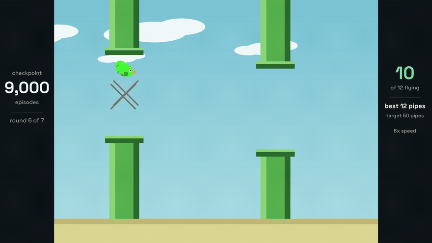

# rl-flappy

A bird, some pipes, and a table of 6,000 numbers that learns to fly through them.
No neural network. It trains on one core in 45 seconds.

The project exists twice. `python/` is the readable original and the one the videos
come from. `rust/` is the same game and the same learner, ported with no dependencies
and about 250 times faster.

[](videos/rl_flappy_rounds_1080.mp4)

That preview plays on the page. Click it for the full clip at 1080p. The 4K master is
`videos/rl_flappy_rounds_4k.mp4` (3840x2160, 7 MB). GitHub and some browser players
refuse that file, so download it and open it locally if the player stays black.

## Start here

You need Python 3.10 or newer, plus numpy and Pillow. ffmpeg is only needed if you
want to render video.

```bash
cd python
pip install numpy pillow
```

Then run these three, in this order, from inside `python/`.

```bash
python3 test_env.py     # 2 seconds. Checks the game and the rules.
python3 train.py        # 45 seconds. Builds the table from scratch.
python3 watch.py        # Watch the trained bird fly in your terminal.
```

Every Python command in this README assumes you are in `python/`. The Rust commands
assume `rust/`.

What you should see:

1. `test_env.py` prints 11 lines that start with `ok`, then `all checks passed`.
2. `train.py` prints a progress line every 2,000 lives, then a summary block.
3. `watch.py` clears the screen and draws the game in ASCII at 30 frames per second.

If `watch.py` says a file is missing, run `train.py` first. It writes
`q_table.json` in the same folder.

## What each file does

| file | what it does | open it when |
|---|---|---|
| `python/env.py` | The game. Gravity, pipes, collisions, and the four numbers the bird sees. | You want to change the difficulty. |
| `python/agent.py` | The table of scores and the rule that improves it. | You want to change how fast it learns. |
| `python/train.py` | Runs 20,000 lives, saves checkpoints, measures the result, draws the curve. | You want more training or a new level set. |
| `python/watch.py` | Plays a saved table in the terminal, in ASCII. | You want to check a checkpoint in two seconds. |
| `python/render.py` | Four checkpoints side by side, as video. | You want the short comparison clip. |
| `python/swarm.py` | 100 checkpoints on one level, with a stats panel. | You want the wide overview clip. |
| `python/rounds.py` | One checkpoint per round, ending at pipe 50. | You want the 4K clip. |
| `python/draw.py` | Shared drawing helpers and font loading. | You want different colours or type. |
| `python/test_env.py` | 11 checks on the rules of the game. | After you edit `env.py`. |
| `python/parity_trace.py` | Prints the same 400 frames as `rust/`, for a diff. | After you edit the physics on either side. |
| `rust/src/env.rs` | The same game, constant for constant. | Same reasons as `env.py`. |
| `rust/src/agent.rs` | The same table, in one flat `Vec<f64>`. | You want to see the index arithmetic. |
| `rust/src/main.rs` | Training loop, evaluation, and the JSON writer. | You want the speed comparison. |

The data flows one way:

```
env.py  ->  train.py  ->  q_table.json  ->  watch.py
               |                        ->  render.py, swarm.py, rounds.py
               ->  stats.json, learning_curve.png, snapshots/
```

## How training works

`python3 train.py` does six things, in this order.

1. Builds the game and an empty table of 6,000 zeros.
2. Runs 20,000 lives. A life ends when the bird dies or reaches the step cap.
3. Starts each life on a new level, generated from the seed.
4. Learns from every step. The mechanics are below.
5. Saves a checkpoint every N lives, if you ask for it.
6. Stops exploring after 8,000 lives. The remaining 12,000 only refine the scores.

### What the state is

Four numbers, each rounded into a bucket. The bird sees nothing else.

| number | buckets | what it measures |
|---|---|---|
| distance | 6 | space left before the next pipe |
| offset | 10 | how far the bird sits above or below the middle of the gap |
| speed | 5 | rising, level, or falling, and how fast |
| height | 10 | how high the bird is on the screen |

Six times ten times five times ten is 3,000 states. Each state gets two scores, one
per button. The bird presses the button with the higher score. That is the whole
policy.

The height number looks redundant next to the offset. It is not. Without it, "safe in
a low gap" and "one pixel from the ceiling" land in the same bucket, and the bird
flies into a wall it cannot see.

### What one step does to the table

Every step runs the same five moves. They live in `update`, in `agent.py`.

1. Read the state. Four numbers, so one row of the table.
2. Press a button. Take the score in that row for that button.
3. Take the reward. 0.1 for staying alive, 5 for a pipe, minus 10 for dying.
4. Build the target. That reward, plus 0.95 times the best score in the next state.
5. Move the score a fraction of the way to the target. The fraction is 0.20.

```
target = reward + 0.95 * best_score_of_next_state
score  = score + 0.20 * (target - score)
```

A real update, on a fresh table. The bird sits in state `(5, 1, 2, 4)`, presses flap,
stays alive, and the next state is worth nothing yet:

```
target = 0.10 + 0.95 * 0.00 = 0.10
score  = 0.00 + 0.20 * (0.10 - 0.00) = 0.02
```

The same row, visited four times in a row, with the values the training run printed:

```
0.000  ->  0.020  ->  0.036  ->  0.052
```

Each visit adds less than the one before, because the target moves as the score
catches up. That is the shape of the whole thing: one row at a time, creeping toward
the truth.

The death step is where the table learns caution. That step pays 0.1 minus 10, and
there is no next state to imagine:

```
target = -9.90
score  = 0.00 + 0.20 * (-9.90 - 0.00) = -1.98
```

Now the row carries a strongly negative number and the bird stops picking it. The
worst score in the shipped table is -9.85, at a state one step from the ground.

### What the table looks like after training

These are real rows from `q_table.json`. The four numbers are distance, offset,
speed, and height.

| row | coast | flap | bird presses |
|---|---|---|---|
| `(5, 4, 0, 3)` | +2.31 | +2.39 | flap |
| `(5, 4, 1, 4)` | +2.19 | +0.71 | coast |
| `(2, 5, 3, 5)` | 0.00 | +3.50 | flap |
| `(0, 4, 2, 4)` | +5.41 | +2.68 | coast |

A score is a sum of discounted future reward. Living alone tops out near 2.0, since
one step pays 0.1 and every step of delay multiplies by 0.95. Anything above 2.0 came
from pipes. Anything negative means the bird expects to die soon.

Of the 3,000 rows, this run touched 1,061. 740 rows tell the bird to coast, 319 tell
it to flap, and 1,941 are still all zeros because the bird never visited them. A zero
row gives both buttons the same score, and the tie break in `greedy` presses flap.

### Why the curve is flat, then steep

The bird must reach a state before the table can learn anything about it. For the
first 6,000 lives it cannot clear the first gap, so every row past that gap stays at
zero and nothing downstream can improve.

Once the bird clears the first gap most of the time, the rows past it start to fill.
That lets it clear the second gap, and so on. This is why almost all of the
improvement lands between 7,000 and 10,000 lives. It is not a slow grind. It is a door
opening.

### How much work that is

2.78 million updates over 20,000 lives, at 139 steps per life on average. One core,
45 seconds. A little over a thousand of the 6,000 numbers end up doing the work.

Exploration is what gets the bird to that door. For the first 8,000 lives it presses a
random button a large share of the time, which is how it discovers that flying up
exists. After that the share drops to 2 percent, one random press in fifty. That 2
percent is also why the training average stays low, since one random flap in a long
run ends it.

### Why those reward sizes

Staying alive pays 0.1. A pipe pays 5, which is 50 steps of hovering. Dying costs 10,
which is 100 steps. The sizes are not decoration: a fresh table starts at zero, so if
dying paid anything at all, crashing would look better than an untried button. It did,
for 40,000 lives, until the death penalty was added.

### What training prints

```
  ep   2000/20000  eps=0.755  mean pipes (last 2000) =   0.00  best =   0    0.3s
  ep   4000/20000  eps=0.510  mean pipes (last 2000) =   0.00  best =   0    0.7s
  ...
  ep  20000/20000  eps=0.020  mean pipes (last 2000) =   5.65  best =  67   43.7s

first 100 episodes : 0.00 pipes/run
last  100 episodes : 6.80 pipes/run  (with 2% random actions)
best single run    : 67 pipes
greedy eval        : 71.00 pipes/run over 20 unseen worlds (min 71, max 71)
long horizon       : [241, 241, 241, 241, 241] pipes (cap 8000 steps)
state space        : 3000 states, 6000 Q values, 1061 states ever visited
train time         : 45.1s
```

The progress line says four things. `eps` is how much guessing is left. `mean pipes`
is the average, including the guessing. `best` is the best single life so far. The
seconds are elapsed time. Do not worry when `mean pipes` sits at 0.00 for the first
few thousand lives. That is normal.

The summary is the part that matters. `last 100 episodes` stays low because of the 2
percent guessing. `greedy eval` is the real score: the policy with no guessing, on 20
levels it never trained on.

### The knobs

| flag | default | what it does |
|---|---|---|
| `--episodes` | 20000 | How many lives to run. 20,000 is enough. 5,000 is not. |
| `--seed` | 23 | Changes the level sequence. Same seed gives the same result. |
| `--alpha` | 0.20 | How far each score moves per step. Higher learns faster and jitters more. |
| `--gamma` | 0.95 | How much the future counts. Lower makes the bird short sighted. |
| `--snap-every` | 0 | Save a checkpoint every N lives. The video scripts need this. |
| `--snap-marks` | 0.40,0.70 | Extra checkpoints at specific lives, or as a fraction. |
| `--out` | script folder | Where to write the four output files. |

Training uses one core. More cores do not make it faster, because there is one bird
and it dies constantly.

## What training writes

| file | size | what it is |
|---|---|---|
| `q_table.json` | 65 KB | The table. 6,000 numbers as nested lists. This is the agent. |
| `snapshots/ep_XXXXX.json` | 65 KB each | The same table, saved part way through the run. Only written with `--snap-every`. |
| `stats.json` | 230 KB | Every number from the run, plus the per life history. |
| `learning_curve.png` | 25 KB | The picture. A thin line per life, a thick average line. |

The table is plain JSON on purpose. You can open it, diff two of them, or copy one
checkpoint somewhere else. There is no model file and no build step.

## Using a trained table

`watch.py` plays a table in the terminal. By default it reads `q_table.json` from the
folder the script sits in.

```bash
python3 watch.py                                # the trained table, until it dies
python3 watch.py --seed 99                      # a level it has never seen
python3 watch.py --steps 200                    # stop after 200 frames
python3 watch.py --fps 60                       # faster playback
python3 watch.py --q snapshots/ep_08000.json    # a checkpoint, see below
```

The last one is the useful one, but it needs checkpoints on disk. Run `train.py
--snap-every 100` once (45 seconds), then point `--q` at `ep_00000`, `ep_08000`,
`ep_12000` and `ep_20000` and watch the bird learn in about ten seconds total, with no
rendering at all.

To use a table from your own script:

```python
from agent import QAgent
from env import Flappy

agent = QAgent.load("q_table.json")
env = Flappy(seed=7)
state = env.reset()
while True:
    state, reward, done = env.step(agent.greedy(state))
    if done:
        break
print(env.pipes_passed, env.death_reason)
```

`agent.greedy(state)` never guesses. `agent.act(state, epsilon)` guesses, and belongs
in training only.

## Making the videos

All three renderers replay checkpoints, so train with checkpoints first.

```bash
python3 train.py --snap-every 100        # 201 checkpoints, one every 100 lives
```

A render takes between 15 seconds and 4 minutes. Every renderer has `--dry-run`,
which prints the outcome of each run and the frame count without encoding. Use it
first.

| command | output | time |
|---|---|---|
| `python3 render.py --episodes 0,7500,8000,20000` | four panels, 720x540, 23s | 15s |
| `python3 swarm.py --birds 100 --pick even` | 100 birds, one level, 29s | 30s |
| `python3 rounds.py` | round robin, 4K at 60fps, 37s | 3m40s |
| `python3 rounds.py --height 1080` | the same clip at 1080p, for drafts | 90s |

Useful flags on `rounds.py`: `--target 50` is the pipe that ends the tape, `--group
12` is birds per round, `--schedule 0,2000,8000,10000` picks which checkpoints to
try, and `--seed` picks the level.

The 4K file is heavy enough that some players refuse it. `videos/rl_flappy_rounds_1080.mp4`
is the same run scaled to 1080p, and that one plays in a browser. If you render your
own, `--height 1080` gives the small version directly, in about 90 seconds.

`swarm.py` needs at least as many checkpoints as birds. `rounds.py` needs the
checkpoints in its schedule, which defaults to every 2,000 lives up to 12,000.

## The same agent in Rust

`rust/` is the same game and the same learner, ported with no dependencies at all.
It trains the identical 20,000 lives in 0.16 seconds instead of 42, and writes a
table the Python tools load without changes.

| | Python | Rust |
|---|---|---|
| 20,000 lives | 42.0s | 0.16s |
| updates per second | 66,000 | 19,300,000 |
| table | numpy array | `Vec<f64>` |
| dependencies | numpy, Pillow | none |

The Rust game is the same game, not a lookalike. `--trace 400` prints four hundred
frames, and `python/parity_trace.py` prints the same four hundred from the Python
side. The two files are identical to twelve decimal places.

Scores still differ between the two, and that is the levels, not the code. Each
version has its own random generator, so the same seed builds different pipes. Fly
the same table through the same levels and the results match level for level.

Which is the real argument for the port. Across 100 seeds the Rust trainer reaches
71 pipes on 8 of them, with a median of 60.5. That sweep takes 19 seconds. In Python
it would take 70 minutes. With one run you tune a lucky seed. With a hundred you
measure a distribution and ship the best. `rust/README.md` has the design notes and
the crate choices for a problem that does not fit in a table.

## Changing the game

The difficulty lives in `python/env.py`, as constants near the top.

| constant | now | what happens if you change it |
|---|---|---|
| `PIPE_GAP` | 30 | Wider gaps make the game easier. |
| `PIPE_SPACING` | 56 | More space means fewer pipes per second. |
| `PIPE_SPEED` | 1.7 | Faster pipes give less time to correct. |
| `GRAVITY` | 0.40 | Heavier gravity makes every flap matter more. |
| `FLAP_V` | -3.2 | A stronger flap overshoots narrow gaps. |

If you change any of these, retrain. An old table still loads, but it expects the old
physics.

The bucket edges in the same file decide the size of the table. If you change them,
the table changes shape and old checkpoints will not load. The reward sizes live
there too, and they decide what the bird cares about.

### More buckets, or more training?

Both, but the buckets cost more than most people expect. These are measured numbers,
not estimates. Same seed, same twenty test levels, only the bucket counts changed.

| buckets (distance, offset, speed, height) | cells | updates per visited cell | pipes per run | train time |
|---|---|---|---|---|
| 6, 10, 5, 10 | 3,000 | 927 | 71.0, every run at the cap | 45s |
| 6, 19, 5, 19 | 10,830 | 200 | 32.7 | 38s |
| 6, 37, 5, 37 | 41,070 | 37 | 7.1 | 27s |

At a fixed budget, more buckets makes the bird much worse. The middle column is the
reason. A cell that sees 37 updates never settles on a number, so the bird acts on
noise.

Paying for it works, up to a point. The 10,830 cell table trained for 100,000 lives
reaches 71.0 again, in 4m34s instead of 45s. It catches up. It does not overtake,
because the small table already flies until the step cap.

Flown past the cap, on eight fresh levels with a 60,000 step limit:

| table | cells | train time | mean pipes | runs that hit the cap |
|---|---|---|---|---|
| small | 3,000 | 45s | 1,707.6 | 7 of 8 |
| fine | 10,830 | 274s | 1,722.8 | 7 of 8 |

That is noise, bought for six times the compute.

A table does not generalise. Every cell learns alone, so bucket 4 and bucket 5 are
strangers even though they are one pixel apart. Adding buckets does not add knowledge.
It splits the same experience into more drawers.

Resolution pays when the task is hard enough that the small table fails. Narrow the
gaps or speed up the pipes and the fine table has room to be better. The other fix is
to stop treating cells as independent, with tile coding or any function approximation,
so one update improves several nearby cells at once.


## Files in the repo

```
python/
  env.py            the game
  agent.py          the table and the learning rule
  train.py          training, evaluation, and the files it writes
  watch.py          terminal playback
  render.py         four panel video
  swarm.py          one hundred bird video
  rounds.py         round robin 4K video
  draw.py           drawing helpers and fonts
  test_env.py       11 checks on the game rules
  parity_trace.py   cross-check against the Rust game
  q_table.json      the trained table
  stats.json        every number in this README
  learning_curve.png  the picture
  assets/fonts/     Space Grotesk, used by the renderers
rust/
  src/env.rs        the same game, same constants
  src/agent.rs      the same table, flat Vec<f64>
  src/main.rs       training loop, evaluation, JSON writer
  Cargo.toml        no dependencies
  q_table_rust.json seed 19, best of a 100 seed sweep
videos/             three clips, a 1080p copy, and a preview GIF
```

`python/snapshots/` is not in the repo. It holds 201 checkpoints, which is 12 MB of
generated JSON. `python3 train.py --snap-every 100` rebuilds it exactly, because
training uses a fixed seed and produces the same table every time.
